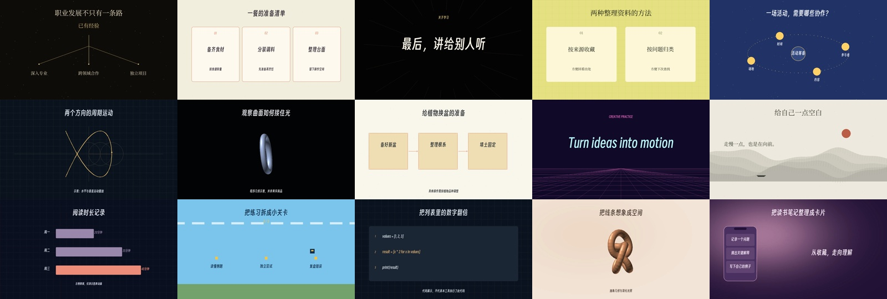
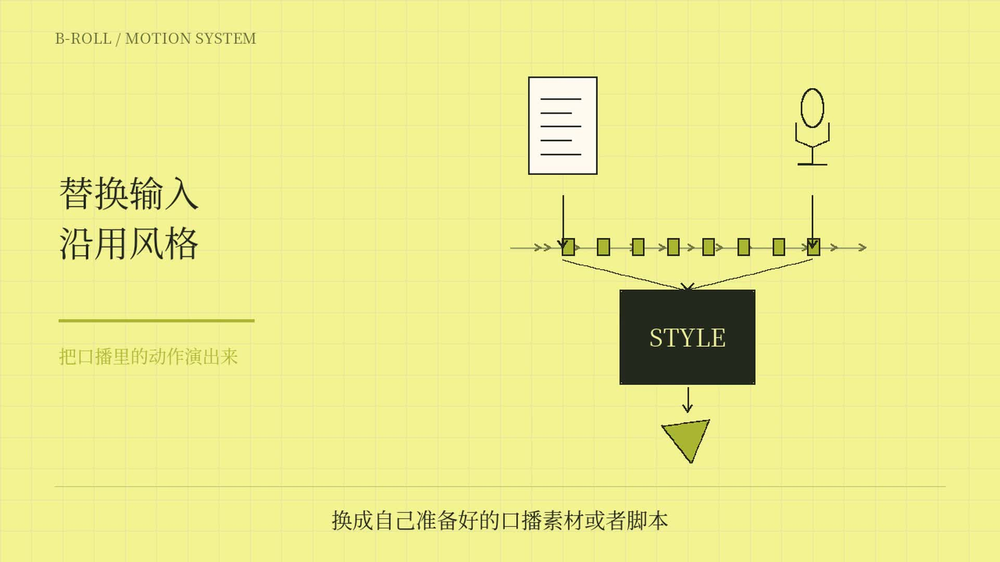
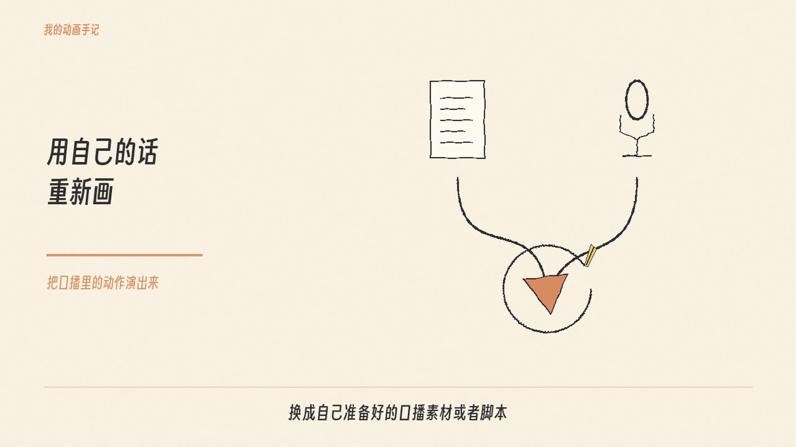
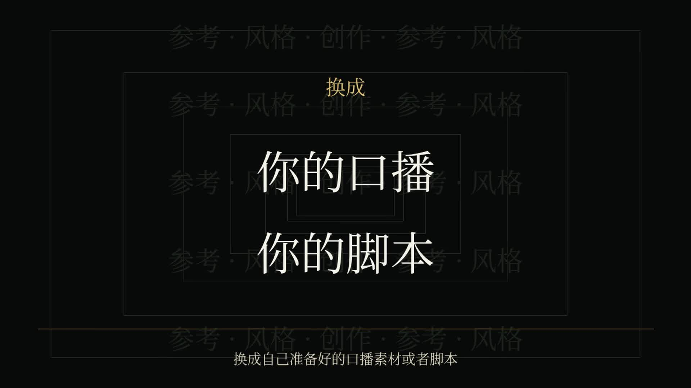

# B-roll 风格工作室 · v1.1.0

把脚本或口播变成信息动画。由科技少女小妖整理，内置十五种画风，使用 Python + Pillow + NumPy + FFmpeg 渲染。

不绑定指定模型。可以让能读取 skill、编写文件并运行 Python 的 GPT/Codex 等智能体完成制作；纯文本聊天窗口不具备本地执行能力。

## 效果预览

下面均为制作过程中实际渲染的画面截图。截图展示视觉风格；动画节奏和动作仍需在成片中检查。

### 十五种基础画风

### 口播动画案例

这些案例使用了按口播定制的动作组件，不代表只换一份文字就能自动得到完全相同的动作。Skill 会指导智能体拆解脚本、设计主体与动作，再编写和检查必要组件。

| 柠檬黄科技 | 奶油手绘 |
| --- | --- |
|  |  |
| 流程装配、分层拆解、参数交互 | 笔触绘制、擦除重画、纸张与手绘对象 |

| 黑金文字 | 暖金画风 |
| --- | --- |
|  |  |
| 关键词推进、纵深穿梭、重音落点 | 暖金光感、对象变形、轨迹与状态变化 |

[下载 v1.1.0 安装包](https://github.com/xi523/broll-studio/releases/tag/v1.1.0) · [查看风格说明](references/styles.md) · [动作设计流程](references/directing.md)

## 安装

解压后，把 **整个 `broll-studio` 文件夹**放进：

- Codex 默认：`~/.codex/skills/`
- 设置了 CODEX_HOME：其下的 `skills/`
- 其他支持 SKILL.md 的智能体：放进该工具的技能目录。

若目标文件夹已存在，先备份旧版本，再替换。新开一个会话，让客户端重新发现技能。

把下面这句话发给智能体即可：

> 使用 $broll-studio，把下面的口播做成奶油手绘风 B-roll，9:16。先设计主体、动作和结果，把口播中的变化演出来，再生成视频。脚本：……

也可以说：

> 用暗底暖金风讲解这三个选择；不要使用原示例的内容。按我的口播时间安排出现，交付 MP4 和可编辑工程。

智能体会按 `references/runtime.md` 准备独立 Python 环境。没有 API key 要求，不需要付费视频生成服务。首次安装依赖需要联网；安装后绘制和编码可离线运行。

## 包含

- 15 种画风：暗底暖金、奶油手绘、黑金、柠檬黄科技、扁平科普、暗底数学、极简发布会、手绘白板、复古霓虹、水墨、数据新闻、像素、代码、柔光立体、渐变社交。
- 14 个布局入口：短句、卡片、流程、时间线、分支、对比、数据条、中心关系、曲线、阶段旅程、代码、手机、意境、产品。
- 横屏、竖屏、方形适配；完整文字换行、缺字/溢出检查；可选音轨。
- 新题材 JSON 示例、可扩展 Python 组件接口、运行回归脚本。
- 开源字体与原许可证。

## 使用边界

“可适配新脚本”指 GPT 设计动作分镜与对象，再选择实现方式并编写必要组件；不是所有题材都能零修改套模板。音视频需要转写，逐字对齐需要真实时间证据。真实三维材质、人物表演、复杂机制和所有语言排版不由本包自动保证。

在独立 macOS Python 环境进行了实际验证；Linux/Windows 的路径与依赖设计为可移植，但本次没有在这两个系统上运行验证。

样例中的数据明确标为演示。生成文件默认无声；原始口播不包含在公开包内。

详细协议见 `SKILL.md` 和 `references/`；验证记录见 `references/validation.md`。

## 1.1 动作导演流程

先设计主体前态、作用与结果，再分别设计画风的材质、运动和镜头。奶油手绘不默认纸卡，柠檬黄科技不等于网格加标签，暖金不绑定分岔。

运行引擎与旧plan保持兼容。本次升级集中在生成决策、分镜、扩展规范和质量检查，并未新增“任意脚本自动演出”的引擎。内置例子是接口示例；新主体和复杂动作仍需智能体定制实现并检查成片。
